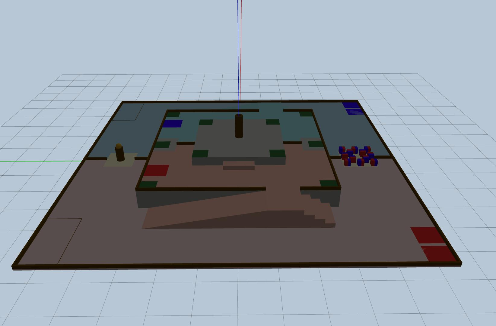

[中文](README.md) | **English**

# ABU Robocon 2027 Gazebo Field

The static Gazebo field model for the ABU Robocon 2027 theme "The Pursuit of Mustika Nusantara".

This project converts the field STEP assembly into an SDF model with collision geometry and per-part colours, for robot navigation, perception, path planning and mechanism validation. The repository maintains field assets only — it does not provide competition robots, match prop entities, controllers, or a referee/scoring system.



> The rules and dimension summary below come from the ABU Robocon 2027 rule material used during development. For official rules, announcements and FAQ, the latest version published by ABU Robocon always takes precedence.

## Contents

```text
robocon_2027_field/          Gazebo field model
  meshes/                    full-field collision meshes
  visuals_fixed/             coloured visual meshes split by part
  model.config               Gazebo model metadata
  model.sdf                  static model, collision and material definitions
worlds/
  robocon_2027_classic.world Gazebo Classic world
launch/
  robocon_2027_field.launch.py  ROS 2 field launch file
pictures/  field preview images
```

The Gazebo bounding box of the field model is approximately `11.1 m × 11.1 m × 1.75 m`, with the origin near the centre of the field and the ground level at about `z = 0`. The source CAD uses millimetres and a Y-up coordinate system; metric scaling and the rotation into Gazebo coordinates have already been applied in the model.

## Environment Requirements

- Ubuntu 22.04
- ROS 2 Humble
- Gazebo Classic with `gazebo_ros`
- `colcon`, `ament_cmake`

```bash
sudo apt update
sudo apt install \
  ros-humble-gazebo-ros-pkgs \
  python3-colcon-common-extensions
```

## Build and Launch

Build in the repository root:

```bash
source /opt/ros/humble/setup.bash
./build.sh
source install/setup.bash
```

Launch the field:

```bash
ros2 launch robocon_2027_gazebo robocon_2027_field.launch.py
```

Run headless:

```bash
ros2 launch robocon_2027_gazebo robocon_2027_field.launch.py gui:=false
```

The world can also be launched directly from an already built workspace:

```bash
source /opt/ros/humble/setup.bash
source install/setup.bash
PACKAGE_SHARE=$(ros2 pkg prefix robocon_2027_gazebo)/share/robocon_2027_gazebo
export GAZEBO_MODEL_PATH="$PACKAGE_SHARE:${GAZEBO_MODEL_PATH:-}"
gazebo --verbose "$PACKAGE_SHARE/worlds/robocon_2027_classic.world"
```

## Attaching Your Own Robot

This repository is not bound to any robot model. You can reuse `robocon_2027_classic.world` inside your own ROS 2 package and spawn the robot through `gazebo_ros/spawn_entity.py` or a custom launch file. The initial robot pose is given in metres in Gazebo world coordinates.

The field is a static collision body. Create the earth blocks, sky blocks, mustika stones and other dynamic entities yourself in your own project, along with the match strategy, sensors and interaction logic.

## Field Specification Summary

All dimensions below are in millimetres.

| Item | Specification |
| --- | --- |
| Competition field | `11000 × 11000` |
| Start area / ground retry area | two of `700 × 700` |
| Storage area | `1000 × 2000` per team |
| Ground shared area | `1200 × 1200`; plus a `1000 × 1000` shared area around the mustika base |
| Level 1 (L1) | `6000 × 6000`, `600` above the ground; ramp length `3500` |
| Level 2 (L2) | `3000 × 3000`, `900` above the ground |
| Handover area | `1000 × 1000`, on the L1 boundary |
| Build point | `500 × 500` |
| Earth block | `350 × 350 × 350` |
| Sky block | `200 × 200 × 200` |
| Mustika stone | diameter `200` |
| Ground mustika base | height `500`, diameter `270` |
| L2 central base | height `800`, diameter `270` |

## Field Preview

-2026-08-15T16_45_36.202817.jpg)

-2026-08-15T16_46_25.606779.jpg)

-2026-08-15T16_46_40.627813.jpg)

-2026-08-15T16_47_02.148857.jpg)

-2026-08-15T16_47_18.429997.jpg)
